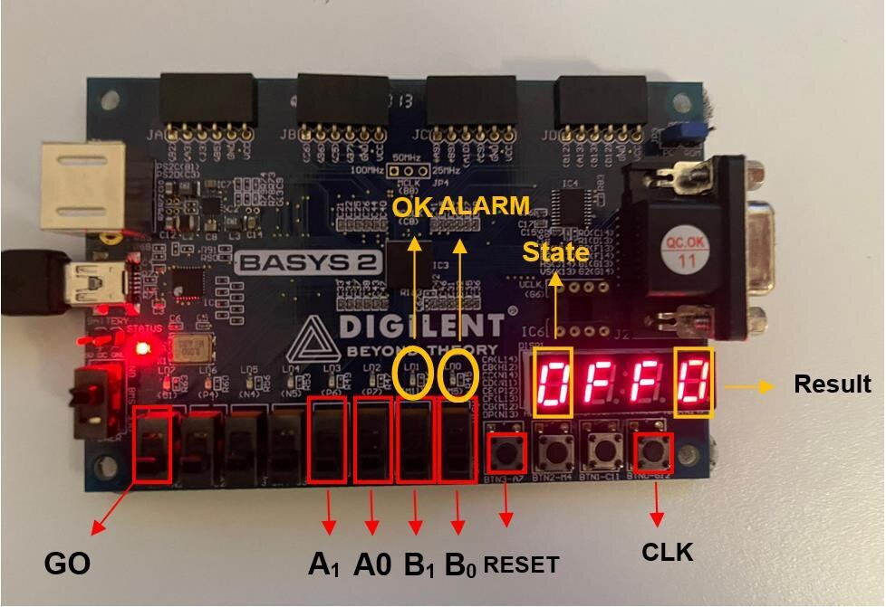
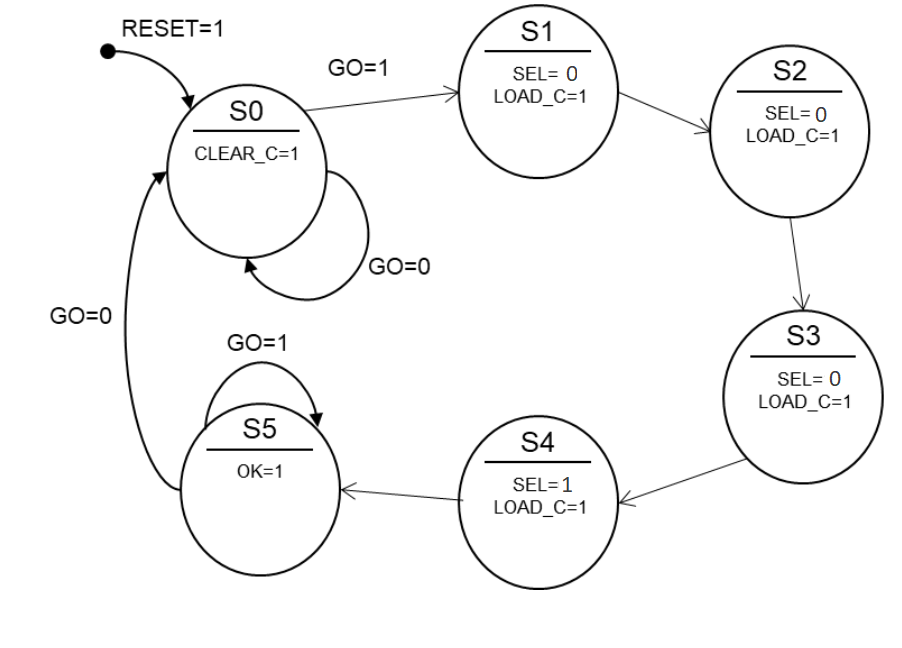
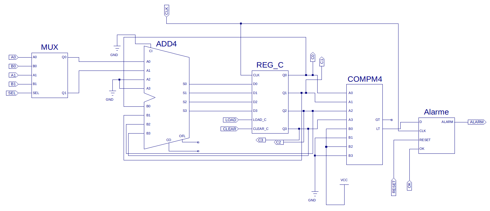
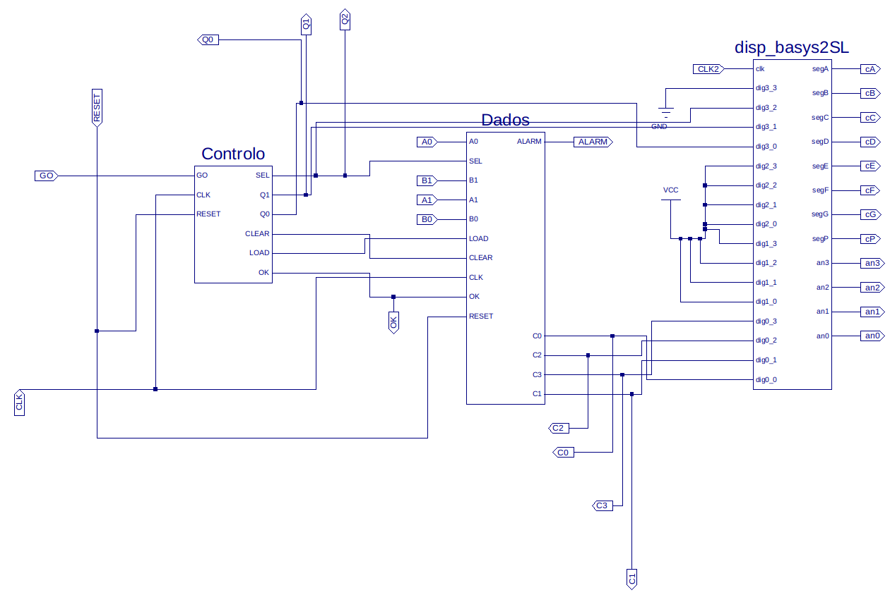
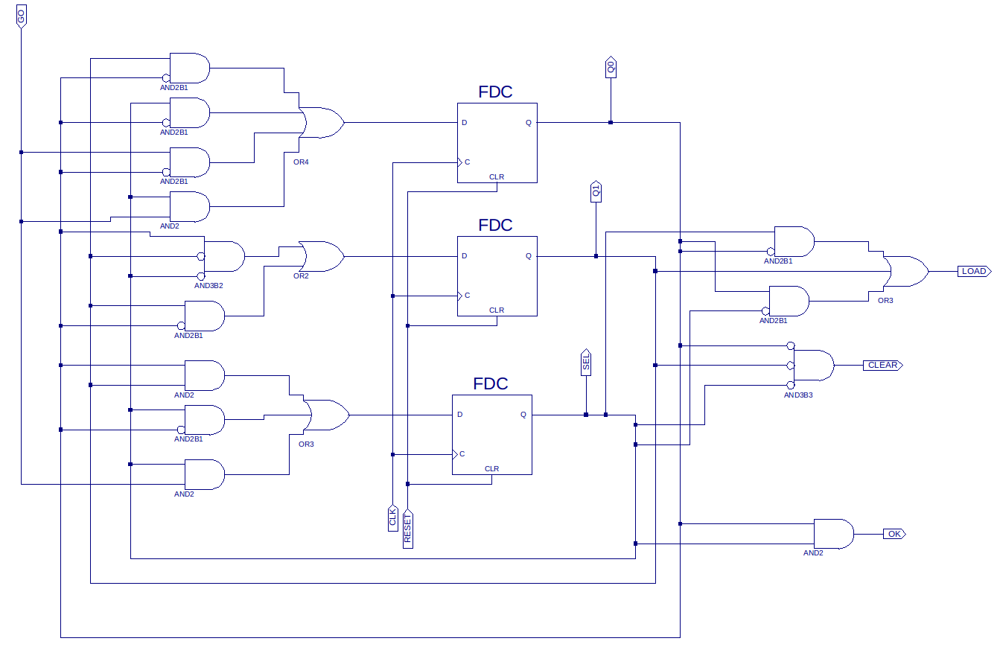
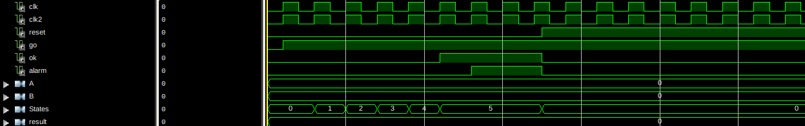

# 🚨 Alarm System — Logic Systems

  
  
  
  
  

Final project of *Sistemas Lógicos* (Logic Systems), Computer Science degree at **NOVA School of Science and Technology (FCT NOVA)**.

  

## About

A **synchronous digital circuit** that evaluates the expression **(3 × A + 1 × B) < 5** and turns on an **alarm** when it's true, where A and B are 2-bit numbers set with switches. The constants and the comparison operator were assigned to each group, so every group built a slightly different alarm.

The circuit was designed by hand (state diagram, transition tables and Karnaugh maps), drawn as schematics in **Xilinx ISE**, validated with **VHDL test benches**, and finally implemented and tested on a **Digilent Basys 2** FPGA board (Xilinx Spartan-3E). The 7-segment display shows the current state and the running result.

## How it works

The design is split into a **datapath** and a **control unit**:

| | |
|---|---|
|  | **Control unit** — a Moore state machine with six states (S0–S5) built from D flip-flops and logic simplified with Karnaugh maps. After `GO`, it steps through the additions (A three times, then B once) and raises `OK` when the expression is complete. `RESET` returns everything to S0. |
|  | **Datapath** — only **one adder** is allowed, so the sum is built over several clock cycles: a multiplexer picks A or B, the adder adds it to the value kept in a 4-bit register (`REG_C`, made of `REGIS` cells with load/clear), and a comparator checks the result against 5. When `OK` is high, the comparison is latched into the `ALARM` output. |

<b>More figures</b>

**Top-level schematic** — control unit, datapath and the display driver:

**Control unit schematic** — three D flip-flops and the next-state/output logic:

**Simulation of test 1** (A = 0, B = 0 → result 0 < 5, so the alarm turns on once `OK` is set):

## Project files

| File | What it is |
|---|---|
| `Project.sch` | Top-level schematic |
| `Controlo.sch` | Control unit (state machine) |
| `DADOS.sch`, `MUX.sch`, `REG_C.sch`, `REGIS.sch`, `Alarme.sch` | Datapath blocks: multiplexer, register, register cell and alarm output |
| `*.sym` | Symbols of the blocks used in the schematics |
| `TESTE1.vhd`, `TesteProjeto.vhd`, `Testeprojeto3.vhd` | System test benches |
| `testecontrolo.vhd`, `testecontrolo1.vhd` | Control unit test benches |
| `Placa.ucf` | Pin assignments for the Basys 2 (switches, buttons, LEDs, display) |
| `ProjectAlarmSystem.xise` | Xilinx ISE project |

To open it, use **Xilinx ISE 14.7** and open `ProjectAlarmSystem.xise`. The 7-segment display driver (`disp_basys2SL.vhd`) was provided by the course and isn't included, so add your own display driver with the same ports to synthesize the full design.

## What I learned

- Designing a sequential circuit from a state diagram down to flip-flop equations
- Splitting a design into a datapath and a control unit
- Simulating with VHDL test benches and reading timing diagrams
- Taking a design all the way to real hardware: pin constraints, programming the FPGA and testing with switches, buttons and LEDs

## Authors

- **Miguel Carmo** ([@MCCProgrammer](https://github.com/MCCProgrammer))
- **Tiago Pinto Pereira**
- **Guilherme João Santos**

---

The assignment statement and course-provided files are not included in this repository, as they belong to the course's teaching staff. This is a student project shared for portfolio purposes.
